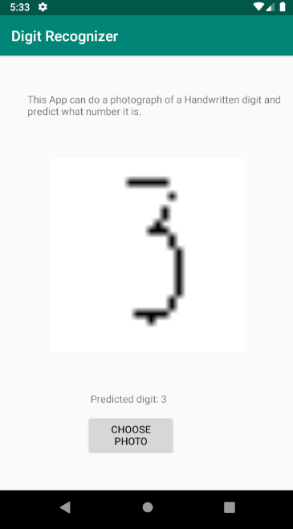

# AndroidAppDigitRecognizer

> An Android app that recognizes handwritten digits using a Neural Network.

[![Codacy Badge][codacy-badge]][codacy-url]

This is a simple Android application that allows you to take a photo of handwritten digits and have them recognized by a neural network model.

The goal of this app was not to build the most accurate digit recognizer—there are better solutions available—but rather to **experiment with neural networks**, explore different architectures and techniques, and then use the best-performing model in a working Android app.

You can find more information about the models I trained, including their performance and code, here:
👉 [Comet ML Dashboard](https://www.comet.com/luposx/mnist-classifier/view/new/panels)

---

## 📲 Usage

1. Download the `.apk` file from the **Releases** section.
2. Install it on your smartphone.
3. Open the app and start recognizing digits!

---

## 📄 License

Distributed under the MIT license.
See [`LICENSE`](https://github.com/LuposX/BostonHousingPrediction/blob/master/LICENSE) for more information.

[license-url]: https://github.com/LuposX/AndroidAppDigitRecognizer/blob/master/LICENSE
[codacy-badge]: https://api.codacy.com/project/badge/Grade/83a9aefbc07c469cb115e69ba3a23208
[codacy-url]: https://www.codacy.com/manual/LuposX/AndroidAppDigitRecognizer?utm_source=github.com&utm_medium=referral&utm_content=LuposX/AndroidAppDigitRecognizer&utm_campaign=Badge_Grade
